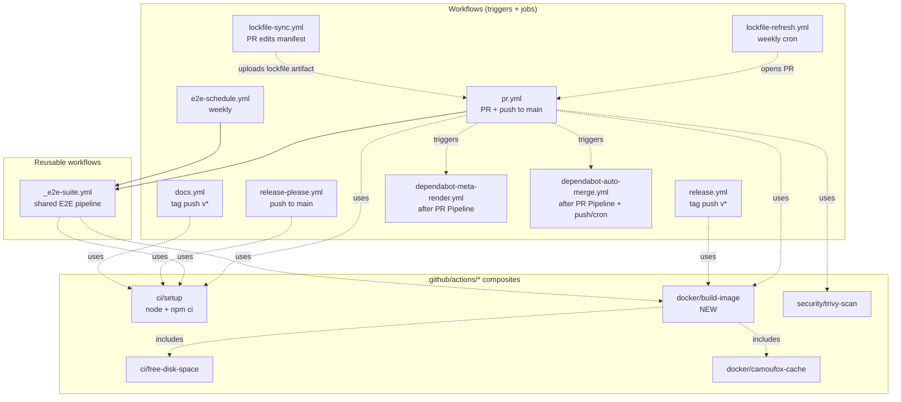
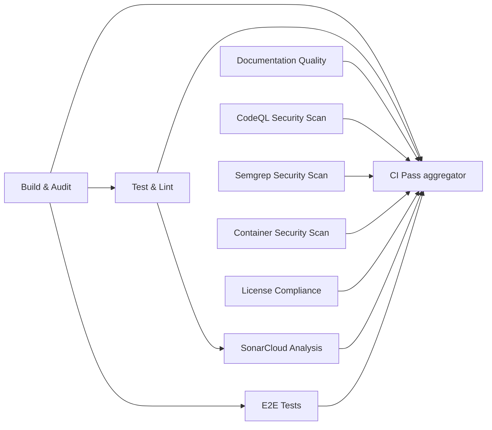

# CI/CD Pipeline Architecture

This document describes the CI/CD architecture for this project. Source of
truth for all CI values lives in [`.github/config/ci-config.yml`](https://github.com/sergienko4/israeli-bank-scrapers-to-actual-budget/blob/main/.github/config/ci-config.yml).

## Overview

The PR DAG lives **inline in `pr.yml`** as the single source of truth. Other
workflows (`release.yml`, `e2e-schedule.yml`, etc.) compose the same logic via
**composite actions** under `.github/actions/*`. Shared values live in
`.github/config/ci-config.yml`. The only reusable workflow is
`_e2e-suite.yml`, which is shared by `pr.yml` (per-PR) and `e2e-schedule.yml`
(weekly cron).

> **Looking for the release → deploy flow** (merge → `release-please` → tag →
> `release.yml` images + `docs.yml` site)? That end-to-end journey has its own
> page: [Release &amp; Deployment Pipeline](https://github.com/sergienko4/israeli-bank-scrapers-to-actual-budget/blob/main/docs/architecture/release-pipeline.md). This page
> covers the **PR gate** that precedes it.



> **Why inline, not a `_ci.yml` reusable workflow?** Reusable workflows
> always prefix nested job check-names with the calling job's name
> (e.g. `ci / Build & Audit`). The branch-protection ruleset on `main`
> requires bare names (e.g. `Build & Audit`), so the PR DAG MUST live
> at the top level of `pr.yml`. DRY across workflows is achieved through
> composites and central config instead.

## The PR DAG (`pr.yml`)



9 parallel jobs at peak (well under GitHub Free's 20-concurrent limit).

## Required check-name preservation

Branch protection requires these 8 exact names. Every `name:` in `pr.yml`
matches this list verbatim:

| Required name              | Emitter                                |
|----------------------------|----------------------------------------|
| `Build & Audit`            | `pr.yml` → `build` job                 |
| `Test & Lint`              | `pr.yml` → `validate` job              |
| `Documentation Quality`    | `pr.yml` → `docs` job                  |
| `CodeQL Security Scan`     | `pr.yml` → `security` job              |
| `Container Security Scan`  | `pr.yml` → `trivy` job                 |
| `License Compliance`       | `pr.yml` → `licenses` job              |
| `SonarCloud Analysis`      | `pr.yml` → `sonar` job                 |
| `E2E Tests / E2E Tests`    | `pr.yml` → `e2e` job → `_e2e-suite.yml`|

Optional new checks (not required — adding a name to the ruleset is a
maintainer action, so new jobs gate merges through `ci-pass` instead):

| Optional name            | Emitter                          |
|--------------------------|----------------------------------|
| `CI Pass`                | `pr.yml` → `ci-pass` aggregator  |
| `Semgrep Security Scan`  | `pr.yml` → `semgrep` job         |

## Release signal guard

`Build & Audit` runs a `Release signal guard` step on pull requests. It fails
the PR when `package.json` `dependencies` or `overrides` change, or when the
Dockerfile `FROM` base image changes, under a title release-please will not
release on — so a bump that ships inside the image can never merge silently.
The Dockerfile is watched because Dependabot's `docker` ecosystem edits only
that file, which a manifest-only comparison cannot see. The step lives inside
an already-required job deliberately — a new top-level job would need a
branch-protection ruleset change to be enforced. Policy:
`scripts/release-signal-logic.mjs`; see
[release-pipeline.md](release-pipeline.md).

## Central config: `.github/config/ci-config.yml`

Holds all CI-only constants in one file:

| Section    | Contents                                            |
|------------|-----------------------------------------------------|
| `project`  | name, owner, repo, repo_url, dockerhub_repo, license|
| `runtime`  | node version, npm version, python version           |
| `docker`   | image name, tag aliases, platforms                  |
| `ci`       | runner OS, timeouts, trivy severity list            |
| `paths`    | config file locations                               |
| `badges`   | shields.io / gist endpoints                         |
| `actions`  | pinned action major versions (single allow-list)    |
| `readme`   | marker allow-list + supported-banks data            |

## Marker fragments

`scripts/render-readme-meta.mjs` reads `.github/config/ci-config.yml` +
`package.json` and rewrites only the content between markers like:

```markdown
<!-- meta:badges:start -->
... rendered content ...
<!-- meta:badges:end -->
```

| Marker name        | Rendered in                                   |
|--------------------|-----------------------------------------------|
| `badges`           | README.md, README.docker-hub.md               |
| `supported-banks`  | README.md, README.docker-hub.md               |
| `tech-stack`       | README.md                                     |
| `docker-image`     | README.md                                     |
| `dockerhub-tags`   | README.docker-hub.md                          |

Run modes:

```bash
npm run meta:render   # write changes
npm run meta:check    # exit 1 on drift (used in CI)
npm run meta:markers  # bash-validate marker pair structure
```

The renderer is **idempotent** (running twice produces identical bytes) and
**refuses** to run on malformed markers or unknown marker names.

### Dependabot auto-render

`tech-stack` embeds versions Dependabot bumps
(`@sergienko4/israeli-bank-scrapers`, `@actual-app/api`, `typescript`,
`vitest`, `engines.node`), and Dependabot cannot run `meta:render` itself, so
every such bump used to fail `Documentation Quality` on drift.

`dependabot-meta-render.yml` closes that gap: after `PR Pipeline` finishes on a
Dependabot pull request, it re-renders the fragments and commits them onto the
Dependabot branch, keeping the gate strict rather than relaxing it. It also
accepts a `workflow_dispatch` with a PR number, for pull requests opened before
the workflow existed.

Two constraints shape the trigger and the token:

- **`workflow_run`, not `pull_request`/`pull_request_target`.** A workflow
  initiated by Dependabot through `pull_request` gets a read-only
  `GITHUB_TOKEN` and no Actions secrets, and `pull_request_target` is
  restricted identically when the PR was *created by* Dependabot. `workflow_run`
  is GitHub's documented two-step handoff: it runs from the default branch,
  outside Dependabot's context, with normal secret access.
- **`RELEASE_TOKEN`, not `GITHUB_TOKEN`, for the push.** A `GITHUB_TOKEN` push
  does not start new workflow runs, which would leave the PR head with no
  status checks at all.

The commit subject carries `[dependabot skip]` so Dependabot keeps rebasing the
branch.

Privilege containment — the job is privileged, so **no head-supplied code
executes**. It checks out the default branch, installs from the default
branch's lockfile with `--ignore-scripts`, overlays only data files
(`package.json`, `README.md`, `README.docker-hub.md`) from the head, and invokes
the renderer through `node` rather than `npm run`. The head tree is restored
only after the last step that executes anything, purely to parent the commit.
The job skips (successfully, without rendering) unless the PR is open, authored
by `dependabot[bot]`, headed in this repository, changes `package.json`, and
changes nothing outside the manifest and the two rendered documents. The push
is never forced, so a concurrent Dependabot rebase rejects it and the next run
renders the newer head.

### Dependabot auto-merge

`dependabot-auto-merge.yml` lands safe Dependabot updates on `main` with no
human step. The decision itself lives in a pure, unit-tested module,
`scripts/dependabot-automerge-logic.mjs`, which reads the
`updated-dependencies` metadata block from the first Dependabot commit:

| Update                                            | Action                          |
|---------------------------------------------------|---------------------------------|
| npm patch / minor                                 | approve + arm auto-merge        |
| GitHub Actions patch / minor                      | approve + arm auto-merge        |
| Docker patch, or a digest-only refresh            | approve + arm auto-merge        |
| any semver-major, or a Docker minor               | label `needs-manual-review`     |
| rotated install-script pin                        | skip (human approves the pin)   |
| unknown ecosystem, unclassified or unparseable    | skip (fail closed)              |

A skip outranks a label: one entry the policy cannot classify skips the whole
PR, even when another entry is a major.

Dependabot writes no `update-type` for Docker, so a Docker entry is
classified from the tag pair in its bump line. A tag change that alters the
variant suffix or the version precision, moves backwards or uses a named tag
is unclassified and skipped.

It runs on `workflow_run` after `PR Pipeline` completes, on a push to `main`,
every six hours, and on `workflow_dispatch` with a PR number. The same two
constraints as the meta-render job apply: `workflow_run` is the documented way
to reach secrets for a Dependabot-created PR, and every write uses
`RELEASE_TOKEN`, whose owner is the code owner the ruleset requires a review
from.

- **Pinned to the judged head.** The approval carries the head SHA as its
  `commit_id`, and auto-merge is armed with `--match-head-commit`, so a later
  push cannot ride an earlier verdict. The ruleset's required checks still gate
  the merge itself.
- **Vetted commits.** An author login comes from a commit's e-mail and a
  subject is free text; anyone with push access can set both, so neither is
  trusted on its own. The first commit must be `dependabot[bot]`'s, and every
  `dependabot[bot]` commit must carry a valid signature from GitHub's
  `web-flow` key and Dependabot's exact author e-mail. That key signs every
  commit made through GitHub's web UI or API, so it proves GitHub made the
  commit, not Dependabot; write access stays the trust boundary. Meta-render
  commits are unsigned, so each `github-actions[bot]` commit is vetted by
  content: one parent, one of the three subjects meta-render writes, and a
  diff limited to the two rendered READMEs plus, for a prune or a rotation
  only, the `allowScripts` block of `package.json` with every other key
  unchanged. A prune may only drop pins. More than 20 commits, any other
  author, a failed vet or an API error means a human owns the merge.
- **Trusted policy.** The policy is checked out from the default branch, never
  from the PR head, and values reach the shell only through `env:`.
- **Fail closed.** A skip verdict, a policy error, an untrusted branch (a
  fork or a non-Dependabot ref), an unexpected or unvetted commit, or any CI
  conclusion other than success for the current head disarms any earlier
  arming. A lookup error never approves or arms. Once the run has confirmed
  it judges the current head of an open Dependabot PR, a later lookup error
  also withdraws any earlier arming. A failure before that point, or a
  cancelled run, touches nothing: the newest head's run or a manual dispatch
  decides. A green re-run comes back through the job and re-arms.
- **Stale runs change nothing.** A run whose pull request is closed, not
  opened by Dependabot or already on a newer head than CI tested exits
  without a write, because a later run owns that decision.
- **Rotated pins never auto-merge.** When meta-render rotates an
  `allowScripts` pin, the PR is held for a human: either the rotation comment
  or the rotation commit subject is enough. The comment marker counts only
  when the `RELEASE_TOKEN` owner posted it, since anyone can paste the text.
  A meta-render push also dismisses the stale approval, and the run for the
  new head re-decides.

A strict required-check set keeps an armed PR from merging once `main` moves
ahead of it. The `rebase-behind` job therefore posts `@dependabot rebase` on
**one** armed, behind PR per run, oldest first; it waits two hours between
nudges to the same head and warns after two unanswered nudges. Dependabot's
own rebase is used instead of the "update branch" button so Dependabot keeps
ownership of the branch.

Scope is `dependabot[bot]` PRs only. A `dependency-bump.yml` PR is still a
human merge. Rationale and rejected alternatives:
[ADR-0002](../decisions/ADR-0002-dependency-auto-merge.md).

## Pinning policy

- **GitHub Actions:** pinned to the **major tag** (e.g., `actions/checkout@v7`).
  See the `actions.pinned_versions` array in `ci-config.yml` for the
  authoritative list. Workflows MUST use a tag from that list and MUST NOT
  inline a different version.
- **Dockerfile base image:** pinned to a **SHA digest** (supply-chain
  hardening for the runtime image).
- **SHA pinning of actions** is **deferred**. Tradeoff: at current scale the
  maintenance burden (manually bumping ~25 SHAs every minor) outweighs the
  supply-chain marginal benefit on top of Dependabot's scheduled grouped
  updates. Revisit when the repo reaches > 50 actions or after a supply-chain
  incident in this ecosystem.

## Composite: `docker/build-image`

Consolidates the Docker build sequence used by `pr.yml` (trivy), `release.yml`
(smoke + push), and `_e2e-suite.yml`. Wraps:

1. `ci/free-disk-space` composite
2. `docker/camoufox-cache` composite — installs the Camoufox build pinned in
   `config/camoufox-pin.json`, cached per pin, installer version and runner
   architecture
3. `docker/setup-buildx-action`
4. `docker/build-push-action`

Inputs (5 max — see plan §R6): `tag`, `platforms`, `push`, `load`,
`cache-suffix`, `labels`.

## Secrets matrix

NO `secrets: inherit` anywhere. Every reusable workflow call lists explicit
mappings.

| Secret                  | Used by                                  |
|-------------------------|------------------------------------------|
| `GITHUB_TOKEN` (built-in) | many                                   |
| `RELEASE_TOKEN`         | release.yml, release-please.yml, dependabot-meta-render.yml, dependabot-auto-merge.yml, lockfile-refresh.yml |
| `SONAR_TOKEN`           | `pr.yml` → sonar job                     |
| `SONAR_ORG`             | `pr.yml` → sonar job                     |
| `SONAR_PROJECT_KEY`     | `pr.yml` → sonar job                     |
| `DOCKERHUB_USERNAME`    | release.yml                              |
| `DOCKERHUB_TOKEN`       | release.yml                              |
| `GIST_SECRET`           | release-please.yml (badge job)           |
| `E2E_TELEGRAM_BOT_TOKEN`| `pr.yml` → e2e → `_e2e-suite.yml`        |
| `E2E_TELEGRAM_CHAT_ID`  | `pr.yml` → e2e → `_e2e-suite.yml`        |

## Dependabot grouping

`.github/dependabot.yml` batches related updates into per-group PRs (06:00
Asia/Jerusalem), bounded by each ecosystem’s `open-pull-requests-limit`:

- **npm** — **daily**, via a `cron` schedule, limit 10. Four groups:
  `dev-dependencies` (development minor/patch), `dev-dependencies-major`
  (development majors, kept apart so a major never blocks the safe batch),
  `pino` (the `pino` + `pino-pretty` production pair, minor/patch) and
  `pino-major` (that pair's majors). All other production dependencies stay
  individually reviewable, one PR per package. Dependabot owns ALL npm deps,
  including the critical `@actual-app/api` and
  `@sergienko4/israeli-bank-scrapers` packages.
- **docker** — weekly on Monday, base image bumps only, no groups. The
  Dockerfile has one base image, so each PR already holds one update.
- **github-actions** — weekly on Monday. Four minor/patch groups
  (actions-core, docker-actions, codeql, security-actions), then
  `actions-major`, which must stay last because a group takes the first
  match. Group patterns match the `owner/repo` dependency name, never a
  sub-path, so the codeql group names `github/codeql-action` exactly.

Every unattended group is limited to minor/patch, and majors are routed to
their own `*-major` group or an ungrouped PR, so a major never shares a PR
with a safe bump. Majors therefore arrive in their own PR, and the
[auto-merge policy](#dependabot-auto-merge) labels them
`needs-manual-review` instead of arming them.

## Lockfile refresh (`lockfile-refresh.yml`)

Dependabot raises versions **declared** in `package.json`. It does not raise
transitive versions recorded **inside** `package-lock.json` once their parents'
ranges already allow a newer release — npm only re-resolves those when
something regenerates the lockfile.

That gap blocked four unrelated Dependabot PRs at once: `browserslist` sat at
`4.28.2` while its parent `header-generator` declared `^4.21.1`, a range that
already allowed the patched `4.28.8`. A CVE against `4.28.2` then failed both
`npm audit` and Trivy on the production tree.

`lockfile-refresh.yml` closes it. Every Thursday 05:00 UTC (and on
`workflow_dispatch`) it runs `npm update --package-lock-only --ignore-scripts`,
then a best-effort `npm audit fix --package-lock-only --ignore-scripts`, and
opens a PR when anything moved:

- **Scope is transitive refresh only**, within ranges parents already permit.
  Raising a declared range stays Dependabot's job. This is **not** a
  Dependabot replacement.
- **No third-party code executes.** `--package-lock-only` ignores
  `node_modules` and downloads nothing, so no install script exists to run.
- **The commit type is computed, not hard-coded** —
  `scripts/summarize-refresh.mjs` emits `fix(deps)` when a non-`dev` entry
  moved, `chore(deps)` otherwise. `npm update` never edits `package.json`, so
  the [release signal guard](#release-signal-guard) cannot see a runtime bump
  made here; a hard-coded `chore` would ship it to users with no release.
- **Pushes with `RELEASE_TOKEN`**, because a PR opened with `GITHUB_TOKEN`
  raises no `pull_request` event — every gate in `pr.yml` would be skipped.
- **Audit fixes stay inside declared ranges.** `--force` is never passed, so
  no declared range is raised. If the fix wants to edit `package.json`, both
  files are restored to their post-`npm update` state: raising a declared
  range is a reviewed change. The step never fails the job; an advisory it
  cannot fix still fails the PR's own `npm run audit` gate.
- **A newer run supersedes the open refresh PR.** Once this run has opened
  its own PR, or proved main already carries every pin, any other open
  same-repository `chore/lockfile-refresh-*` PR is closed (branch deleted).
  The close runs last, so a failed run never leaves the week without a
  refresh, and a stuck PR never blocks the next week.
- **Auto-merge is armed** with `RELEASE_TOKEN` and `--match-head-commit`, so
  the PR squash-merges once every required check passes, and never lands a
  head other than the one this run pushed.
- **A refresh that crosses a major is not armed.** A loose range (`*`,
  `>=1.0.0`) lets `npm update` or `npm audit fix` move a transitive pin
  across a major while staying inside it. The summary compares main's
  lockfile with the refreshed one, including relocated packages; when it
  counts a major, the PR is labelled `needs-manual-review` instead. A missing
  or non-numeric count fails the run before anything is pushed.

`lockfile-sync.yml` covers the opposite direction: a same-repository PR that
edits `package.json` (an `overrides` floor, say) from a machine that cannot
reach the registry. It refuses a branch-supplied `.npmrc`, runs
`npm install --package-lock-only --ignore-scripts` on the runner against the
pinned public registry, and requires a working tree that is clean or differs
by `package-lock.json` alone (untracked files included), then applies the
canonical-form guard. When the committed lockfile is out of date, it uploads
the regenerated one as the `package-lock` artifact and fails the check; the
run summary lists the commands that download and commit it. The job holds no
secret and only `contents: read`: a `pull_request` workflow runs the branch's
own definition, so a token there would be readable by the code under review.
After the commit, the next run finds no diff and passes. It triggers on
`package.json` only, so a PR that edits just the lockfile is never checked,
and it skips Dependabot, release-please and refresh branches, which commit
their own lockfile.

A companion gate, `npm run lint:lockfile` (in `validate:ci`), fails the build
on a `resolved` URL pointing anywhere but `registry.npmjs.org` or on a `sha1-`
integrity — both symptoms of a proxy or mirror rewriting the lockfile.
`npm run refresh-lockfile` repairs foreign hosts in place; integrity
downgrades fail closed, since a weakened hash cannot be strengthened without
re-fetching the tarball. Rationale and rejected alternatives:
[ADR-0001](../decisions/ADR-0001-scheduled-lockfile-refresh.md). The
auto-merge decision is recorded in
[ADR-0002](../decisions/ADR-0002-dependency-auto-merge.md).

## Git hooks

Local verification is split across two stages so the cost lands where it
belongs. Nothing was dropped or weakened when the stages were separated —
every gate below still runs before any commit reaches the remote.

### Commit stage — `.husky/pre-commit`

Answers **"is the snapshot I am recording internally correct?"** — 5 gates:
`type-check` (src), ESLint (cached), Biome, config-structure, PII scan.

### Push stage — `.husky/pre-push`

Answers **"is what leaves this machine correct as a whole?"** — 9 gates:
`type-check:test`, `type-check:e2e`, `npm run audit`, build, TypeDoc, ESLint
(uncached), markdownlint, circular deps, coupling.

A push that only deletes a remote branch ships no code, so the hook detects
the all-zero local SHA and exits without running anything.

ESLint appears in both stages deliberately. The commit stage lints against
`.eslintcache` for speed; a cache is only ever as trustworthy as its
invalidation, so the push stage re-runs it with no cache at all and that
uncached run is what the branch is judged on.

TypeDoc is a push gate rather than a CI-only one because it fails on a class
of error nothing else catches: an interface referenced by an exported
signature but not itself exported. That is a real API-surface defect, and
finding it in CI costs a full round-trip to learn something a local 23s gate
already knew.

### Why this split

The gates run in parallel, so a stage costs its slowest gate plus the
contention between them, not the sum. Measured on this repo (minimum of
three alternating runs, to discount ambient load): the previous single
twelve-gate hook took **35s**, the commit stage now takes **24s** — a 31%
cut on the operation performed most often — and the push stage adds **40s**
once per push rather than once per commit.

The win is 31% rather than 60% because the two tall poles, `type-check` and
ESLint, both stay in the commit stage: each must build the TypeScript
program before it can report anything, and that build is the floor for the
stage. Gates cheaper than that floor were free to keep, so they were kept.

### Acceptance stage — CI only

Every acceptance-stage gate runs in CI and **only** in CI:

| Gate | Owning CI job |
| --- | --- |
| unit tests + coverage thresholds | `validate` (`validate:ci`) |
| ESLint canary fixtures | `validate` (`validate:ci`) |
| lockfile canonicality (`lint:lockfile`) | `validate` (`validate:ci`) |
| config manifest SSoT | `validate` |
| markdown link check (lychee) | `docs` |
| Semgrep | `semgrep` |
| CodeQL | `security` |
| Trivy + Docker image build | `trivy` |
| mocked + Telegram E2E | `e2e` (`_e2e-suite.yml`) |

Those gates left the hooks because they are slow, need Docker or the
network, and already have to pass before merge — running them twice
bought no safety. The unit-test gate was also actively harmful locally:
vitest spawns one fork per CPU, and on a busy workstation a fork that
misses vitest's hardcoded 60-second startup budget is killed. Its tests
then silently never run, and the resulting coverage shortfall fails the
commit for a defect that does not exist. CI runs it on a quiet,
right-sized machine.

Neither hook shells out to Docker, so a stopped Docker Desktop cannot
block a commit or a push.

Nothing is unguarded: `ci-pass` aggregates every job above, so a gate
that is missing locally still blocks the merge.

## Adding a new check

1. Add the job to `pr.yml` with a clear `name:`.
2. If it needs new secrets, reference them via `${{ secrets.X }}` in the
   job's `env:` block; secret presence checks belong in steps (job-level
   `if:` cannot access the `secrets` context).
3. If it needs a new central value, add it to `.github/config/ci-config.yml`
   under the appropriate section.
4. If it's branch-protection-required, add the exact `name:` to the ruleset.
5. Update the table in this document.

## Rollback plan

If `pr.yml` breaks post-merge (e.g., required check name not emitting):

1. Revert the squash-merge commit.
2. Restore the pre-PR state of: `pr.yml`, `release.yml`, `release-please.yml`,
   `docs.yml`, `_e2e-suite.yml`, `package.json`.
3. Delete the new infra: `.github/config/`,
   `.github/actions/docker/build-image/`, `scripts/render-readme-meta.mjs`,
   `scripts/check-readme-markers.sh`, `tests/render-readme-meta.test.ts`,
   `.github/dependabot.yml` (revert to previous form), this file.

No data involved.
