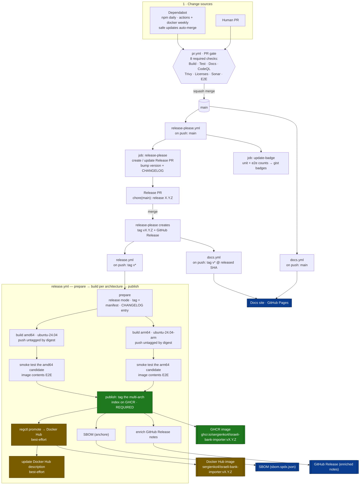
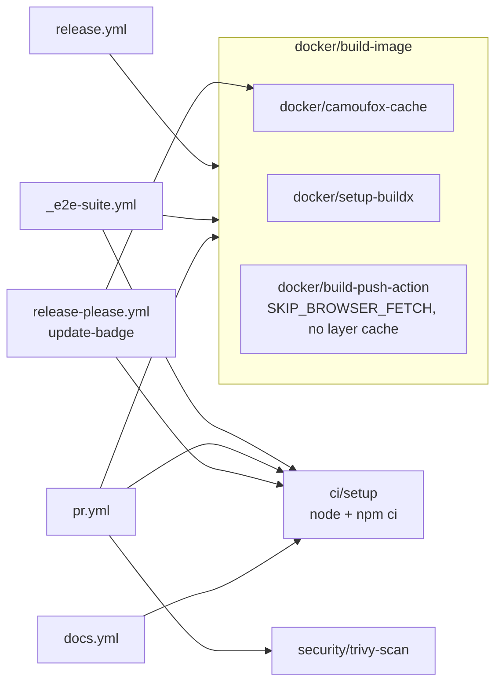

# Release &amp; Deployment Pipeline

**One place** to see how a change becomes a published release. Everything from
a merged PR to multi-arch Docker images, an enriched GitHub Release, an SBOM,
and the live docs site — as a single directed flow instead of six workflow
files you have to read side-by-side.

- **Release orchestration:** [`release-please.yml`](https://github.com/sergienko4/israeli-bank-scrapers-to-actual-budget/blob/main/.github/workflows/release-please.yml)
- **Deployment (images):** [`release.yml`](https://github.com/sergienko4/israeli-bank-scrapers-to-actual-budget/blob/main/.github/workflows/release.yml)
- **Deployment (docs):** [`docs.yml`](https://github.com/sergienko4/israeli-bank-scrapers-to-actual-budget/blob/main/.github/workflows/docs.yml)

For the **PR-check DAG** (the 8 required checks that gate a merge) see the
companion [CI/CD Pipeline](https://github.com/sergienko4/israeli-bank-scrapers-to-actual-budget/blob/main/docs/architecture/ci-pipeline.md) page — this page picks up **after**
a PR is green and merged.

---

## The whole flow, in one DAG



**Legend:** green = required (release fails if it fails) · amber =
best-effort (logged as a warning, never fails the release) · blue = published
output.

---

## At a glance

| # | Stage | Workflow | Trigger | Key jobs / steps | Produces |
|---|-------|----------|---------|------------------|----------|
| 1 | Feed | Dependabot + `lockfile-refresh.yml` | npm daily 06:00 · actions + docker Mon 06:00 · lockfile refresh Thu 05:00 UTC, and again once main moves past it | grouped npm / docker / actions PRs (incl. critical `@actual-app/api` + scraper); safe patch/minor PRs auto-merge via `dependabot-auto-merge.yml` | dep PRs |
| 2 | Gate | `pr.yml` | PR + push to `main` | 8 required checks + `CI Pass` aggregator | green merge |
| 3 | Release PR | `release-please.yml` → `release-please` | push to `main` | create/update Release PR (version + CHANGELOG) | Release PR |
| 3 | Badges | `release-please.yml` → `update-badge` | push to `main` | run unit + E2E, push counts to gist | 2 shields badges |
| 3 | Docs | `docs.yml` | push to `main` | TypeDoc + `mkdocs build --strict` | Pages deploy |
| 4 | Tag | `release-please.yml` | merge Release PR | create tag `vX.Y.Z` + GitHub Release | tag + release |
| 5 | Images | `release.yml` → `prepare`, `build`, `publish` | push tag `v*` | native build + smoke test per arch → tag GHCR index → Docker Hub promote → SBOM → notes | images + SBOM |
| 5 | Docs | `docs.yml` | push tag `v*` | rebuild at released SHA | Pages deploy |

---

## `release.yml` jobs

Three jobs. Nothing is tagged until both architectures passed their smoke
test, so a broken image never reaches a user.

1. **`prepare`** resolves the release mode (below). For a tag it checks out
   the tag, verifies it matches `config/release-please/manifest.json`, and
   verifies the CHANGELOG entry.
2. **`build`**, one leg per architecture, each on its own native runner
   (`ubuntu-24.04` for amd64, `ubuntu-24.04-arm` for arm64). A failed leg
   cancels the other (`fail-fast`). Each leg:
   - builds via `docker/build-image` and pushes the image to GHCR
     **untagged**, by digest;
   - pulls that exact candidate and runs the image contents E2E
     (`tests/e2e/image-contents.e2e.test.ts`) against it. Among other
     things, that test launches Camoufox and checks the scraper API, the
     font set and the Camoufox layer. Tags built before that test existed
     (up to v1.43.8) get the older `createScraper().scrape` check instead;
   - logs the candidate's compressed layer sizes and the runner's free disk;
   - uploads the candidate digest as an artifact.
3. **`publish`** runs only when both legs passed. It checks that exactly two
   digests arrived and joins them into one multi-arch index with
   `docker buildx imagetools create`, which writes the GHCR tags. **This is
   the required publish target.** Then:
   - **promote GHCR → Docker Hub** with `regctl image copy` (best-effort).
     regctl is used instead of a buildx push because Docker Hub's edge proxy
     rejects BuildKit's concurrent multi-arch uploads;
   - **SBOM** (anchore, scanned from the GHCR image) → **enriched release
     notes** → **attach SBOM + notes to the GitHub Release** → **update
     Docker Hub description** (best-effort).

> **GHCR is primary and required; Docker Hub is a best-effort mirror.** If
> Docker Hub auth or push fails, the release still succeeds and the notes
> advertise only the GHCR pull command.

Each job gets only the token permissions it needs: `build` can write
packages, and only `publish` can write release contents.

### Release modes

| Mode | Trigger | Builds | Publishes |
|------|---------|--------|-----------|
| tag-push | release-please pushes `vX.Y.Z` | the tag | GHCR + Docker Hub tags, SBOM, release notes |
| republish | `workflow_dispatch` with `tag` | the tag's image content, with today's `.github/actions/` overlaid from the workflow commit | same as tag-push |
| rehearsal | `workflow_dispatch` with `rehearsal: true` | the dispatched commit | only GHCR `:rehearsal`; every step that needs Docker Hub or release secrets is skipped |

### Rehearsing a release

Run the full build, smoke test and index publish from a branch without
releasing anything:

```bash
gh workflow run release.yml --ref <branch> -f rehearsal=true
```

The run tags only `ghcr.io/sergienko4/israeli-bank-importer:rehearsal`. Run one
rehearsal at a time: the workflow has no concurrency group, and two runs
would race for that tag.

### Why the build is fast

- **Native runners.** arm64 builds on an arm64 runner instead of under QEMU
  emulation on amd64, and both legs run in parallel.
- **No layer cache.** Exporting the GHA layer cache cost about 170 s per
  release build, more than the layers it saved, so no release build reads or
  writes one.
- **A reproducible Camoufox layer.** The Dockerfile installs Camoufox into a
  staging root with fixed owners, modes and timestamps, so a release that
  keeps the same Camoufox pin and base image produces the same layer digest.
  GHCR and Docker Hub then skip that layer on push, and users skip it on
  pull: it is about 300 MB of the roughly 530 MB compressed image per
  architecture.
- **Only the Windows fonts.** The image ships the Windows font set that the
  default fingerprint uses; see
  [`CAMOUFOX_OS`](https://github.com/sergienko4/israeli-bank-scrapers-to-actual-budget/blob/main/docs/deployment/docker-run.md#browser-fingerprint-os-camoufox_os).

---

## Reused building blocks (composite actions)

Every build path funnels through the same composites, so a fix lands once and
propagates everywhere.



`_e2e-suite.yml` is the only **reusable workflow** (called by `pr.yml` and
`e2e-schedule.yml`); it builds the `:e2e` image, seeds a budget, runs the
scraper smoke + import runs, then the full E2E suite. `update-badge` needs
`docker/camoufox-cache` because `portal-ui.e2e.test.ts` launches the product's
Camoufox browser and never skips.

---

## Secrets by workflow

| Secret | Used by |
|--------|---------|
| `GITHUB_TOKEN` (built-in) | GHCR login, Pages, SBOM |
| `RELEASE_TOKEN` | `release-please.yml`, `release.yml` (release edits) |
| `DOCKERHUB_USERNAME` / `DOCKERHUB_TOKEN` | `release.yml` (Docker Hub mirror + description) |
| `GIST_SECRET` | `release-please.yml` → `update-badge` |
| `SONAR_TOKEN` / `SONAR_ORG` / `SONAR_PROJECT_KEY` | `pr.yml` → sonar |
| `E2E_TELEGRAM_BOT_TOKEN` / `E2E_TELEGRAM_CHAT_ID` | `_e2e-suite.yml`, `release-please.yml` → `update-badge` |

No `secrets: inherit` anywhere — every reusable-workflow call maps secrets
explicitly.

---

## Publish targets

| Target | Image ref | Status |
|--------|-----------|--------|
| GHCR | `ghcr.io/sergienko4/israeli-bank-importer:vX.Y.Z` | **primary — release fails if this fails** |
| Docker Hub | `sergienko4/israeli-bank-importer:vX.Y.Z` | mirror — best-effort, promoted from GHCR via regctl |
| GitHub Release | tag `vX.Y.Z` | enriched notes + `sbom.spdx.json` attached |
| GitHub Pages | `https://sergienko4.github.io/israeli-bank-scrapers-to-actual-budget/` | docs site |

Both image tags are byte-identical multi-arch manifest lists
(`linux/amd64`, `linux/arm64`).

---

## Dependency bumps always cut a release

A dependency that ships inside the published image changes what users actually
run, so it must reach them as a tagged release — never as a silent merge.

| Change | Dependabot prefix | Releases? |
|--------|-------------------|-----------|
| npm `dependencies` / `overrides` | `fix(deps)` | ✅ patch |
| Dockerfile base image | `fix(docker)` | ✅ patch |
| npm `devDependencies` | `chore(deps-dev)` | ❌ never ships |
| GitHub Actions workflow pins | `chore(ci)` | ❌ never ships |

Two mechanisms keep this true:

1. **`.github/dependabot.yml`** sets `prefix`/`prefix-development` so runtime
   bumps arrive already titled `fix(deps)`. It deliberately omits
   `include: scope`, which used to append a second scope
   (`chore(deps)(deps):`) that the conventional-commit parser cannot read — so
   release-please dropped those commits entirely.
2. **The `Release signal guard`** step in `pr.yml` → *Build & Audit* fails any
   PR that changes `dependencies`, `overrides` or the Dockerfile `FROM` base
   image under a non-releasing title. Configuration alone is not a guarantee;
   the guard is the enforcement half. The Dockerfile is covered because
   Dependabot's `docker` ecosystem never touches `package.json`, so a manifest
   comparison alone would let a base-image bump merge silently. Policy and
   messages live in `scripts/release-signal-logic.mjs`, exercised end to end by
   `tests/e2e/release-signal.e2e.test.ts`.

Before this, runtime bumps merged as `chore(deps)` and produced no version
bump, no tag and no image — scraper updates had to be retitled by hand.

`typescript` majors are pinned back by an `ignore` entry: TypeScript 7 is
rejected by the `typedoc` and `typescript-eslint` peer ranges, so `npm ci`
fails with `ERESOLVE` before any job runs. Remove the entry once both peers
publish stable TS 7 support.

---

## Cutting a release (operator steps)

1. Merge feature PRs to `main` with **conventional-commit** titles
   (`feat:` minor, `fix:`/`refactor:` patch). `release-please` keeps a Release
   PR up to date automatically.
2. When ready to ship, **merge the Release PR** (`chore(main): release X.Y.Z`).
3. `release-please` tags `vX.Y.Z` and opens a GitHub Release; the tag push then
   fires `release.yml` (images) and `docs.yml` (docs) in parallel.
4. Confirm the **Docker Build &amp; Publish** run is green and pull
   `ghcr.io/sergienko4/israeli-bank-importer:vX.Y.Z`.

## If the deploy fails

- **A smoke test or build leg failed** — nothing was tagged. The candidate
  stays untagged on GHCR, users see no change. Fix and re-run, or re-run the
  failed jobs if the failure was transient.
- **Docker Hub push failed** — non-fatal by design; the image is on GHCR. Pull
  from GHCR or re-run to retry the mirror.
- **`Tag vX.Y.Z does not match manifest`** — the tag was pushed out of band;
  it must equal `config/release-please/manifest.json`.
